# Learnix Database & Backend Architecture (Part 3)

This document specifies the relational PostgreSQL 17 schema, Entity-Relationship (ER) diagram, Row-Level Security (RLS) matrix, transactional database functions/triggers, Supabase Storage bucket rules, and TypeScript backend services for **Learnix** (`awakujbdjoajjoxuvygn`).

---

## 1. Entity-Relationship (ER) Diagram

```mermaid
erDiagram
    PROFILES ||--o{ USER_PERMISSIONS : "has"
    PERMISSIONS ||--o{ USER_PERMISSIONS : "grants"
    ROLES ||--o{ ROLE_PERMISSIONS : "maps"
    PERMISSIONS ||--o{ ROLE_PERMISSIONS : "assigned_to"
    PROFILES ||--o{ TEACHER_REQUESTS : "submits"
    DEPARTMENTS ||--o{ EDUCATIONAL_LEVELS : "contains"
    DEPARTMENTS ||--o{ CLASSES : "organizes"
    EDUCATIONAL_LEVELS ||--o{ CLASSES : "scopes"
    PROFILES ||--o{ STUDENT_TEACHER_ASSIGNMENTS : "student_or_teacher"
    CLASSES ||--o{ STUDENT_TEACHER_ASSIGNMENTS : "cohort"

    PROFILES ||--o{ COURSES : "teaches"
    DEPARTMENTS ||--o{ COURSES : "categorizes"
    COURSES ||--o{ CHAPTERS : "contains"
    CHAPTERS ||--o{ LESSONS : "contains"
    COURSES ||--o{ COURSE_ENROLLMENTS : "enrolls"
    PROFILES ||--o{ COURSE_ENROLLMENTS : "studies"
    LESSONS ||--o{ LESSON_PROGRESS : "tracks"
    LESSONS ||--o{ LESSON_NOTES : "annotates"
    PROFILES ||--o{ FAVORITES : "bookmarks"

    COURSES ||--o{ EXAMS : "evaluates"
    EXAMS ||--o{ QUESTIONS : "includes"
    QUESTIONS ||--o{ QUESTION_OPTIONS : "offers"
    EXAMS ||--o{ EXAM_SESSIONS : "schedules"
    EXAMS ||--o{ EXAM_ATTEMPTS : "records"
    EXAM_ATTEMPTS ||--o{ STUDENT_ANSWERS : "captures"
    EXAM_ATTEMPTS ||--|| RESULTS : "grades"
    EXAM_ATTEMPTS ||--o{ EXAM_VIOLATIONS : "monitors"

    COURSES ||--o{ ASSIGNMENTS : "assigns"
    ASSIGNMENTS ||--o{ ASSIGNMENT_SUBMISSIONS : "receives"

    NOTIFICATIONS ||--o{ NOTIFICATION_RECIPIENTS : "delivers"
    CONVERSATIONS ||--o{ CONVERSATION_PARTICIPANTS : "includes"
    CONVERSATIONS ||--o{ MESSAGES : "threads"
    MESSAGES ||--o{ MESSAGE_ATTACHMENTS : "attaches"

    COURSES ||--o{ ATTENDANCE : "conducts"
    ATTENDANCE ||--o{ ATTENDANCE_RECORDS : "logs"

    COURSES ||--o{ COURSE_REVIEWS : "rated_by"
    PROFILES ||--o{ TEACHER_REVIEWS : "reviewed_by"
    COURSES ||--o{ CERTIFICATES : "awards"
    PROFILES ||--o{ STUDY_SESSIONS : "telemetry"
    PROFILES ||--o{ USER_DEVICES : "registers"
    PROFILES ||--o{ AUDIT_LOGS : "audits"
```

---

## 2. Complete Table Catalog (38 Domain Tables)

### A. Users & RBAC
| Table | Primary Key | Key Foreign Keys & Constraints | Purpose |
| :--- | :--- | :--- | :--- |
| `profiles` | `id (uuid)` | `id -> auth.users(id) ON DELETE CASCADE`, `department_id -> departments(id)`, `educational_level_id -> educational_levels(id)` | 1:1 user profile with `role` (`admin`, `teacher`, `student`), `status`, and `preferred_locale` |
| `roles` | `id (uuid)` | `UNIQUE (code)` | Canonical platform roles (`admin`, `teacher`, `student`) |
| `permissions` | `id (uuid)` | `UNIQUE (code)`, `CHECK (code ~ '^[a-z0-9_]+:[a-z0-9_]+$')` | Fine-grained capabilities (`users:manage`, `courses:create`, `exams:manage`, etc.) |
| `role_permissions` | `id (uuid)` | `role_id -> roles(id)`, `permission_id -> permissions(id)`, `UNIQUE (role_id, permission_id)` | Default capability mapping per canonical role |
| `user_permissions` | `id (uuid)` | `user_id -> profiles(id)`, `permission_id -> permissions(id)`, `granted_by -> profiles(id)` | Explicit per-user permission grants or overrides |
| `teacher_requests` | `id (uuid)` | `user_id -> profiles(id)`, `department_id -> departments(id)`, `reviewed_by -> profiles(id)` | Teacher privilege applications and admin review status |

### B. Educational Structure
| Table | Primary Key | Key Foreign Keys & Constraints | Purpose |
| :--- | :--- | :--- | :--- |
| `departments` | `id (uuid)` | `head_teacher_id -> profiles(id)`, `UNIQUE (code)` | Academic departments |
| `educational_levels` | `id (uuid)` | `department_id -> departments(id)`, `UNIQUE (code)`, `CHECK (rank_order >= 1)` | Academic levels / years |
| `classes` | `id (uuid)` | `department_id -> departments(id)`, `educational_level_id -> educational_levels(id)`, `advisor_teacher_id -> profiles(id)` | Student cohorts/classes with capacity limits |
| `student_teacher_assignments` | `id (uuid)` | `student_id -> profiles(id)`, `teacher_id -> profiles(id)`, `class_id -> classes(id)`, `CHECK (student_id <> teacher_id)` | Explicit mapping between students, teachers, and cohorts |

### C. Courses & Learning Content
| Table | Primary Key | Key Foreign Keys & Constraints | Purpose |
| :--- | :--- | :--- | :--- |
| `courses` | `id (uuid)` | `teacher_id -> profiles(id) ON DELETE RESTRICT`, `department_id`, `educational_level_id`, `class_id`, `UNIQUE (slug, code)` | Courses with status (`draft`, `published`, `archived`), language, and passing thresholds |
| `course_enrollments` | `id (uuid)` | `course_id -> courses(id)`, `student_id -> profiles(id)`, `UNIQUE (course_id, student_id)` | Student enrollments with `progress_percent` (`0..100`) |
| `chapters` | `id (uuid)` | `course_id -> courses(id) ON DELETE CASCADE`, `UNIQUE (course_id, position)` | Ordered course modules/chapters |
| `lessons` | `id (uuid)` | `chapter_id -> chapters(id)`, `course_id -> courses(id)`, `UNIQUE (chapter_id, position)` | Video, article, PDF, presentation, or quiz lessons |
| `lesson_progress` | `id (uuid)` | `lesson_id -> lessons(id)`, `course_id -> courses(id)`, `student_id -> profiles(id)`, `UNIQUE (lesson_id, student_id)` | Per-lesson completion and playback position |
| `favorites` | `id (uuid)` | `student_id -> profiles(id)`, `course_id -> courses(id)`, `lesson_id -> lessons(id)` (`XOR` check constraint) | Student bookmarked courses or lessons |
| `lesson_notes` | `id (uuid)` | `lesson_id -> lessons(id)`, `student_id -> profiles(id)` | Private timestamped student study notes |

### D. Examinations & Integrity
| Table | Primary Key | Key Foreign Keys & Constraints | Purpose |
| :--- | :--- | :--- | :--- |
| `exams` | `id (uuid)` | `course_id -> courses(id)`, `chapter_id -> chapters(id)`, `created_by -> profiles(id)` | Timed exams with proctoring and violation limits |
| `questions` | `id (uuid)` | `exam_id -> exams(id) ON DELETE CASCADE`, `UNIQUE (exam_id, position)` | Exam questions (`single_choice`, `multiple_choice`, `true_false`, `short_answer`, `essay`) |
| `question_options` | `id (uuid)` | `question_id -> questions(id) ON DELETE CASCADE`, `UNIQUE (question_id, position)` | Answer choices with `is_correct` flag |
| `exam_sessions` | `id (uuid)` | `exam_id -> exams(id)`, `class_id -> classes(id)`, `created_by -> profiles(id)`, `CHECK (ends_at > starts_at)` | Scheduled live examination windows |
| `exam_attempts` | `id (uuid)` | `exam_id -> exams(id)`, `exam_session_id -> exam_sessions(id)`, `student_id -> profiles(id)`, `UNIQUE (exam_id, student_id, attempt_number)` | Student exam attempts with expiration timer and violation counter |
| `student_answers` | `id (uuid)` | `attempt_id -> exam_attempts(id)`, `question_id -> questions(id)`, `selected_option_id -> question_options(id)`, `UNIQUE (attempt_id, question_id)` | Per-question student responses |
| `results` | `id (uuid)` | `attempt_id -> exam_attempts(id) UNIQUE`, `exam_id -> exams(id)`, `course_id -> courses(id)`, `student_id -> profiles(id)` | Immutable graded exam results |
| `exam_violations` | `id (uuid)` | `attempt_id -> exam_attempts(id)`, `student_id -> profiles(id)` | Proctoring violation events (`low`, `medium`, `high`, `critical`) |

### E. Assignments, Notifications, Messaging, Attendance, Ratings & Platform Features
| Table | Primary Key | Key Foreign Keys & Constraints | Purpose |
| :--- | :--- | :--- | :--- |
| `assignments` | `id (uuid)` | `course_id -> courses(id)`, `lesson_id -> lessons(id)`, `created_by -> profiles(id)` | Course/lesson assignments |
| `assignment_submissions` | `id (uuid)` | `assignment_id -> assignments(id)`, `student_id -> profiles(id)`, `graded_by -> profiles(id)`, `UNIQUE (assignment_id, student_id)` | Student submissions & grades |
| `notifications` | `id (uuid)` | `sender_id -> profiles(id)`, `course_id -> courses(id)` | Notification payloads |
| `notification_recipients` | `id (uuid)` | `notification_id -> notifications(id)`, `recipient_id -> profiles(id)`, `UNIQUE (notification_id, recipient_id)` | Per-user read/archive state (with partial index on unread rows) |
| `conversations` | `id (uuid)` | `course_id -> courses(id)`, `created_by -> profiles(id)` | Direct or group messaging threads |
| `conversation_participants` | `id (uuid)` | `conversation_id -> conversations(id)`, `user_id -> profiles(id)`, `UNIQUE (conversation_id, user_id)` | Thread participants |
| `messages` | `id (uuid)` | `conversation_id -> conversations(id)`, `sender_id -> profiles(id)`, `reply_to_id -> messages(id)` | Messages inside a thread |
| `message_attachments` | `id (uuid)` | `message_id -> messages(id) ON DELETE CASCADE` | Storage attachments for messages |
| `attendance` | `id (uuid)` | `course_id -> courses(id)`, `class_id -> classes(id)`, `recorded_by -> profiles(id)` | Attendance sessions |
| `attendance_records` | `id (uuid)` | `attendance_id -> attendance(id)`, `student_id -> profiles(id)`, `UNIQUE (attendance_id, student_id)` | Student attendance statuses (`present`, `absent`, `late`, `excused`) |
| `course_reviews` | `id (uuid)` | `course_id -> courses(id)`, `student_id -> profiles(id)`, `CHECK (rating BETWEEN 1 AND 5)` | Course star ratings & reviews |
| `teacher_reviews` | `id (uuid)` | `teacher_id -> profiles(id)`, `student_id -> profiles(id)`, `course_id -> courses(id)`, `CHECK (teacher_id <> student_id)` | Teacher ratings & feedback |
| `certificates` | `id (uuid)` | `course_id -> courses(id)`, `student_id -> profiles(id)`, `UNIQUE (certificate_number, verification_hash)` | Verifiable completion certificates |
| `study_sessions` | `id (uuid)` | `student_id -> profiles(id)`, `course_id -> courses(id)`, `lesson_id -> lessons(id)` | Learning & AI telemetry sessions |
| `audit_logs` | `id (uuid)` | `actor_id -> profiles(id)` | Administrative & security audit log |
| `user_devices` | `id (uuid)` | `user_id -> profiles(id)`, `UNIQUE (user_id, device_fingerprint)` | Trusted device registry |
| `platform_settings` | `key (text)` | `updated_by -> profiles(id)` | Global key-value configuration |
| `contact_messages` | `id (uuid)` | `user_id -> profiles(id)`, `handled_by -> profiles(id)` | Public Contact Us inquiries |

---

## 3. Row-Level Security (RLS) & Anti-Tampering Guarantees

Every table in `public` has RLS enabled (`rls_enabled_tables = 43 / 43`). Helper functions live in the non-exposed `private` schema with `set search_path = ''` and are invoked via `(select private.*())` for cached Postgres `initPlan` evaluation.

1. **Preventing Role Escalation (`private.protect_profile_privileged_columns`)**:
   - A `BEFORE UPDATE` trigger on `public.profiles` rejects any attempt by a non-admin to modify `role`, `status`, or `email`.
2. **Preventing Grade Tampering**:
   - `public.results`: Students only have `SELECT` permission on their own published results (`student_id = (select auth.uid()) and is_published = true`). Only the course teacher or an admin can `INSERT`, `UPDATE`, or `DELETE` rows in `public.results`.
   - `public.student_answers`: `private.protect_student_answer_grading_columns` trigger blocks students from inserting or updating `points_awarded`, `is_correct`, or `teacher_feedback`.
   - `public.assignment_submissions`: `private.protect_submission_grading_columns` trigger blocks students from modifying `grade_points`, `graded_by`, `graded_at`, `feedback`, or setting `status = 'graded'`.
3. **Preventing Unauthorized Course & Lesson Access**:
   - Non-preview lessons (`is_preview = false`), exams, questions, assignments, and course storage buckets (`course-videos`, `course-materials`, `course-pdfs`, `course-presentations`) require `(select private.is_enrolled_in_course(course_id))`, `(select private.is_course_teacher(course_id))`, or `(select private.is_admin())`.
4. **Preventing Cross-Student Data Leaks**:
   - `profiles_select_policy` allows a student to read only their own profile (`id = (select auth.uid())`) and public instructor profiles (`role = 'teacher'`). Other students' private profiles, results, notes, favorites, submissions, and attendance records are invisible (`0 rows`).

---

## 4. Supabase Storage Buckets

| Bucket ID | Visibility | Size Limit | Allowed MIME Types | Access Policy |
| :--- | :--- | :--- | :--- | :--- |
| `profile-pictures` | Public Read | 5 MB | `image/jpeg`, `image/png`, `image/webp`, `image/avif` | Anyone can read; owner writes to `{user_id}/*` |
| `course-videos` | Private | 500 MB | `video/mp4`, `video/webm`, `video/quicktime` | Course teacher/admin writes `{course_id}/*`; enrolled students read |
| `course-materials` | Private | 50 MB | PDF, ZIP, TXT, Markdown, PNG, JPEG, WebP | Course teacher/admin writes `{course_id}/*`; enrolled students read |
| `course-pdfs` | Private | 50 MB | `application/pdf` | Course teacher/admin writes `{course_id}/*`; enrolled students read |
| `course-presentations` | Private | 100 MB | PPT, PPTX, PDF | Course teacher/admin writes `{course_id}/*`; enrolled students read |
| `assignment-attachments` | Private | 25 MB | PDF, ZIP, DOC, DOCX, TXT, PNG, JPEG | Enrolled student writes `{course_id}/{student_id}/*`; course teacher reads/writes |
| `message-attachments` | Private | 25 MB | PDF, PNG, JPEG, WebP, TXT, ZIP | Conversation participants read/write `{conversation_id}/{user_id}/*` |
| `certificates` | Private | 15 MB | `application/pdf`, `image/png` | Teacher/admin issues `{student_id}/*`; student reads own certificates |
